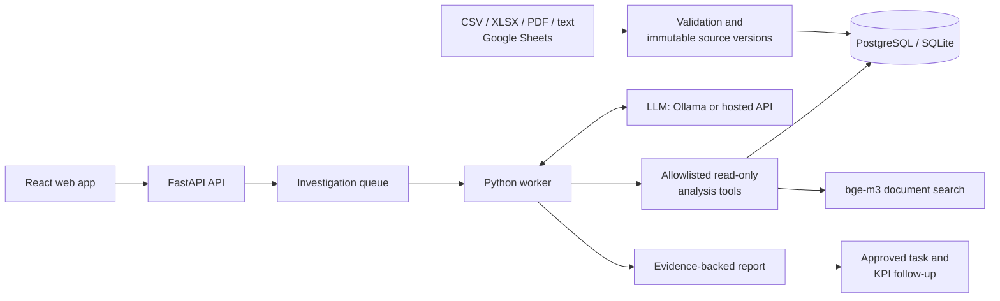

# SanketAI

An AI business investigator for Nepalese SMEs: it follows the evidence from an unusual change in your numbers to its strongest supported explanation.

**Demo video:** _link to be added_ · **Architecture:** [docs/architecture.md](docs/architecture.md) · **License:** [MIT](LICENSE)

## The problem

A small online seller in Nepal sees sales drop just before Dashain, or margin fall while revenue grows. The answer is usually spread across several places: the orders export, stock counts, supplier shipments, courier invoices, ad spend, and a supplier's email. Owners rarely have an analyst, so they guess, often wrongly. A chatbot that answers from general knowledge does not help, because the cause is in *their* data.

## What SanketAI does

You upload your business data (CSV/XLSX datasets plus PDFs, text or Markdown documents such as supplier letters and complaint logs) and ask a question in plain language, for example “Why did our sales drop just before Dashain?”. SanketAI then:

1. **Measures** what changed, comparing the latest 28 days with the 28 days before.
2. **Investigates** like an analyst: the AI agent forms competing hypotheses and chooses read-only analysis tools (inventory, supplier shipments, deliveries, courier fees, supplier prices, marketing, customers, document search), and each tool adds numbered evidence.
3. **Challenges** its own leading explanation: it looks for counter-evidence, and every hypothesis must cite evidence IDs that were actually collected.
4. **Reports** the strongest supported explanation with a causal chain, competing hypotheses, what is still unknown, and a link from every claim to the source row or document excerpt behind it. Margin questions also get a waterfall chart showing where the contribution went.
5. **Acts and follows up**: you can approve a recommended action as an internal task. SanketAI checks the KPI when a new 28-day window of data arrives and opens a fresh investigation if the target is missed.

Example from the included test data: asked why margin fell while revenue rose 16%, SanketAI measures that Peakline Parcel's fee per delivery rose 32.4% (NPR 46,134) and Everest Tech Traders' unit costs rose 10% (NPR 77,804), finds both parties' price letters among the documents, and rejects the discount that the finance note blames.

Also included: discovery runs (“Find what is going wrong”) without a question, a live trail of each step, “Challenge conclusion” re-runs, JSON report export, live Google Sheets connections, approval-gated tasks, scheduled KPI checks, authenticated sessions, and an audit history.

## How AI is used

SanketAI's core logic runs on AI output; the model does not just write the text shown to the user.

- **Planning:** a large language model (local Ollama, or a hosted OpenAI-compatible API such as Groq with `openai/gpt-oss-120b`) returns schema-validated JSON choosing the next tool, its query and the current hypotheses. The worker executes that choice.
- **Conclusion:** the model reasons over a compact index of all collected evidence and a deterministic draft, and returns a structured conclusion. SanketAI rejects it if it cites evidence that was never collected, and caps its confidence at medium.
- **Semantic retrieval:** `bge-m3` embeddings (multilingual, so Romanized-Nepali complaints match English questions) decide which document passages become evidence.

If the model is unavailable or its output fails validation, `auto` mode falls back visibly to a deterministic analysis, and the report says which engine produced it.

### AI usage disclosure

AI output is consumed programmatically in these exact places:

| Where | What happens to the AI output |
| --- | --- |
| `backend/app/agent.py` · `model_json()`, `hosted_models_json()` and `hosted_json()` | Call the model (moving to the next model in `SANKET_LLM_FALLBACK_MODELS` when one is rate-limited or down) and parse its reply into the Pydantic schemas `AgentStep` and `AgentConclusion` (`backend/app/schemas.py`); invalid output raises and triggers the fallback. |
| `backend/app/agent.py` · `investigate()` | The planning loop reads `step.tool` and `step.query` from the model and runs that tool through `Tools.call()` (`backend/app/analysis.py`), which only accepts names in `TOOL_NAMES`; `step.hypotheses` are recorded in the trail. |
| `backend/app/agent.py` · `validate_conclusion()` | Checks the model's conclusion (every cited evidence ID must exist, supported and rejected hypotheses need evidence, confidence capped at medium); the result becomes the report's root cause, hypotheses, unknowns and recommended action. |
| `backend/app/worker.py` · `process_one()` | When the report is actionable, the model's `recommended_action` becomes the title of a pending task that waits for human approval. |
| `backend/app/retrieval.py` · `embed()` and `rank()`; `backend/app/ingestion.py` · `with_embeddings()` | `bge-m3` vectors are stored with each document chunk at upload; `rank()` scores chunks by cosine similarity to the question, and the top matches become evidence. |

## Architecture



The API never runs an investigation itself: it snapshots the active sources, queues the job and returns at once. A separate worker claims the job with a lease, runs the agent, and commits each tool step so the browser can show progress live. Tools are fixed Python functions over the stored data; the model can only choose among them, never run code, SQL or URLs. See [docs/architecture.md](docs/architecture.md) for the full design, data rules and trade-offs.

## Technology

| Layer | Technology |
| --- | --- |
| Frontend | React 19, Vite, TypeScript, Tailwind CSS v4, shadcn/ui (Radix), TanStack Query |
| Backend | Python 3.14, FastAPI, SQLAlchemy, Alembic, Pydantic |
| Worker | Python process with lease-based job claiming and scheduled monitoring |
| Database | PostgreSQL (Docker/production) or SQLite (local development) |
| AI | Ollama (`qwen3`) or any OpenAI-compatible API (tested with Groq `openai/gpt-oss-120b`); `bge-m3` embeddings via Ollama |
| Testing | pytest, Playwright, Ruff, Prettier; GitHub Actions CI |
| Deployment | Docker Compose with an nginx frontend |

## Run with Docker

From the repository root:

```powershell
python scripts/setup_env.py
docker compose up --build -d
```

Open **http://localhost:5173**. The initial email is `founder@sanketai.local`; the generated password is `SANKET_ADMIN_PASSWORD` in your local `.env`. The setup script preserves an existing file. Change the email/password before the first startup if desired. No default production password is supplied.

Sign in and select **Load demo evidence**, then ask “Why did our sales drop?” or select **Find what is going wrong**. Alternatively, select **Load margin demo** and ask “Revenue increased, so why is our margin falling?”. Each pack loads only into an empty workspace. The demos are explicitly synthetic; the couriers and suppliers are fictional. Actions propose internal tasks; they do not modify a real CRM or notify a team.

For a realistic end-to-end test, build the HimalayanMart Gadgets dataset (see [Native development](#native-development)), drag one scenario folder onto the Sources page, and ask its question. The strongest folders are `2_margin_squeeze` (“Revenue increased, so why is our margin falling?”) and `5_dashain_stockout` (“Why did our sales drop just before Dashain?”). The zip's `ANSWER_KEY.md` lists what was planted in each folder so you can check the result.

Use an existing host Ollama installation:

```powershell
ollama pull qwen3:8b
ollama pull bge-m3      # document embeddings for semantic search (about 1.2 GB)
```

Document search uses `bge-m3` embeddings from the local Ollama even when the planner uses a hosted model; documents are embedded when uploaded. Without the model, search falls back to keyword matching. Set `SANKET_EMBEDDING_MODEL=` (empty) to turn embeddings off.

The first model download needs several GB of disk and suitable RAM. Set `SANKET_OLLAMA_MODEL` for your hardware; the model must support structured JSON responses. `auto` mode visibly falls back to deterministic analysis if the model is missing, offline, or invalid. Set `SANKET_AGENT_MODE=ollama` to require model reasoning, or `deterministic` for offline analysis.

To use a hosted OpenAI-compatible model instead of Ollama (for example Groq, Google Gemini or OpenRouter), set these in `.env` and restart the API and worker:

```
SANKET_LLM_PROVIDER=openai
SANKET_LLM_BASE_URL=https://api.groq.com/openai/v1
SANKET_LLM_API_KEY=<your key; never commit it>
SANKET_LLM_MODEL=openai/gpt-oss-120b
SANKET_LLM_REASONING_EFFORT=low
SANKET_LLM_FALLBACK_MODELS=openai/gpt-oss-20b
```

Investigation prompts, including business data from your sources, are then sent to that provider; check its data-use terms before uploading real data. Responses use strict JSON-schema output (set `SANKET_LLM_STRICT_SCHEMA=false` for providers that do not support it). Free tiers limit tokens per minute: SanketAI waits up to 60 seconds when the provider returns `Retry-After`. When a model is still rate-limited (for example after Groq's daily limit) or down, the request moves to the next model in `SANKET_LLM_FALLBACK_MODELS`, and SanketAI skips the exhausted model until the provider says it resets; the report names the model that answered. On Groq, `openai/gpt-oss-20b` gave the same answers as `openai/gpt-oss-120b` on the margin and Dashain test packs. When every model is exhausted, SanketAI falls back visibly to deterministic analysis. Evidence IDs in a model conclusion are validated, but numbers written in its prose are not; the margin bridge and evidence tab hold the calculated figures.

```powershell
docker compose logs -f api worker
docker compose down
```

`down` preserves the PostgreSQL volume. Do not add `--volumes` unless you intend to destroy the database.

## Native development

Requires Node 24 and Python 3.14.

```powershell
python scripts/setup_env.py
python -m venv .venv
.venv\Scripts\python.exe -m pip install -r backend/requirements-dev.txt
npm ci
```

Start the API in one terminal:

```powershell
cd backend
..\.venv\Scripts\python.exe -m alembic upgrade head
..\.venv\Scripts\python.exe -m uvicorn app.main:app --reload
```

Start the worker in a second terminal:

```powershell
cd backend
..\.venv\Scripts\python.exe -m app.worker
```

Start the frontend from the repository root in a third terminal:

```powershell
npm run dev
```

Open http://localhost:5173. API documentation is at http://127.0.0.1:8000/docs. The Vite proxy forwards `/api` to the backend; no browser API key is needed. SQLite is the native default. All settings are loaded from the root `.env`, with process environment variables taking precedence. Linux/macOS use `.venv/bin/python` instead.

Export inspectable synthetic source files if needed:

```powershell
.venv\Scripts\python.exe scripts/export_demo.py
```

For a larger, realistic test set, build the **HimalayanMart Gadgets** dataset: a year of a fictional Nepali mobile-accessories seller (about 28,000 orders across marketplace, website, Facebook & Instagram and TikTok; cash on delivery and wallets; three fictional couriers and four suppliers; the real 2025–26 festival calendar and the monsoon). It contains five scenario packs, each exported on the date its planted problem appears (cash-on-delivery refusals, a margin squeeze, an ad boost that did not pay, monsoon delays and a Dashain stockout), plus a README, data dictionary and answer key:

```powershell
.venv\Scripts\python.exe scripts/export_gadgets.py --out HimalayanMart_Gadgets_Nepal_dataset.zip
```

## Data contracts

Upload complete datasets, with matching IDs across files and ISO dates such as `2026-09-30`. All amounts are NPR and must be non-negative finite numbers. Upload at least 56 days of orders for comparable 28-day windows. Orders with `delivered` or `completed` status contribute recognized revenue; other supported values are `cancelled`, `returned`, `pending`, and `shipped`.

| Type | Required columns |
| --- | --- |
| orders | id, date, customer_id, product_id, quantity, revenue, status |
| products | id, name, category, price, cost |
| inventory | date, product_id, supplier_id, stock |
| suppliers | id, name, product_id, promised_date, received_date |
| deliveries | order_id, promised_date, delivered_date, route; optional: courier, fee |
| marketing | date, channel, spend, impressions, clicks |
| customers | id, segment, location, signup_date |
| expenses | date, category, amount |
| purchases | date, supplier_id, product_id, quantity, unit_cost |

`received_date` and `delivered_date` may be blank for pending shipments. The `courier` and `fee` delivery columns may be omitted entirely or left blank; record courier fees there, and stock purchases in `purchases`, but not again in `expenses`, or the contribution estimate counts them twice. Cost of goods uses the latest purchase `unit_cost` on or before each sale and falls back to the current catalog `cost` when no purchase exists. XLSX reads the first worksheet; dates must be ISO text and formulas must be exported as values. Documents support text PDFs, TXT, and Markdown. Scanned PDFs need OCR before uploading. Limits: 10 MB/file, 50,000 dataset rows, 100 PDF pages, and 500 document chunks. Extra table columns are ignored.

New investigations use the newest upload for each table type; older source versions remain attached to existing reports. Documents accumulate as evidence. Sources cannot be edited in place; to correct data, upload a complete corrected file. Deleting a source (the trash button on the Sources page) removes it permanently; if it was the current version, the previous version of that type becomes current again. Investigations that used the source, and their actions, are deleted with it after a confirmation that lists them, because a report cannot outlive its evidence; deletion is refused while such an investigation is still running, and every deletion is recorded in the audit trail. On the Sources page, the download button exports a dataset as CSV (the normalized snapshot SanketAI analyses) or a document as its extracted text; cells that spreadsheets would run as formulas are prefixed with an apostrophe.

**Live Google Sheets.** On the Sources page, **Connect Google Sheet** imports one tab as a dataset and checks it again daily, every 6 hours, hourly, or only when you select **Sync now**. Share the sheet as *Anyone with the link: Viewer*, keep one dataset per tab with the contract's column names in the first row, and paste the tab's link (it ends in `#gid=…`). Each sync that finds changed data stores a new source version (same validation as uploads); unchanged data adds nothing, and earlier reports keep the version they used. Anyone with the link can view such a sheet; private sheets (Google sign-in) are not supported yet. The server only fetches `docs.google.com` and Google's `*.googleusercontent.com` export hosts. Disconnecting stops syncing and keeps the imported data. Daraz and accounting-software connectors are not implemented yet.

Do not mix demo files with real datasets. Demo loading is available only in an empty workspace and can be disabled with `SANKET_DEMO_ENABLED=false`. To switch demos, use **Reset workspace** on the Workspace & audit page: it deletes all sources, investigations, actions and live connections (the audit trail and sign-in are kept), requires typing RESET, waits for running investigations, and is unavailable whenever demo loading is disabled, so never in production.

## Checks

```powershell
.venv\Scripts\python.exe -m pytest backend/tests -q
.venv\Scripts\python.exe -m ruff check backend
.venv\Scripts\python.exe -m ruff format --check backend
npm run format:check
npm run build
npx playwright install chromium
npm run test:e2e
docker compose config --quiet
```

Playwright starts isolated API/worker/frontend services on ports 8011/5174 with an expendable SQLite database in `.cache`; it never touches your configured business database. It exercises sign-in, the demo, investigation, source inspection, approval, stale-data protection, challenge, the margin waterfall chart, and mobile navigation. GitHub Actions runs the Python, frontend, and browser checks.

## Deployment and boundaries

This is a production-oriented **single-business foundation**, not a public multi-tenant service. Before deployment, set `SANKET_FRONTEND_ORIGIN` to the exact HTTPS origin, terminate TLS at your reverse proxy, and use:

```powershell
docker compose -f compose.yaml -f compose.production.yaml up --build -d
```

Production mode enforces secure cookies, HTTPS configuration, and disabled demo loading. Preserve the database volume, configure backups and resource limits, and pin tested image digests. Migration runs as a separate startup service. Monitor API/worker logs; `/api/health` checks the database and the workspace runtime screen shows worker heartbeat status.

To change the administrator password after bootstrap:

```powershell
cd backend
..\.venv\Scripts\python.exe -m app.manage reset-password
```

This revokes existing sessions. Changing the bootstrap environment password alone does not change an existing account.

See [architecture and tradeoffs](docs/architecture.md) and the downloaded [Vercel React skill](docs/skills/vercel-react-best-practices/SKILL.md). The Vercel skill was sourced from the official repository through the [skills.sh listing](https://skills.sh/vercel-labs/agent-skills/vercel-react-best-practices); two relevant rule files are included under `docs/skills/`.

## Limitations

- **Two explained scenarios.** The deterministic engine explains supplier delay → stockout → revenue and courier or supplier price rises → lower contribution. Other questions (late deliveries, ad spend, cash-on-delivery refusals, churn) stay inconclusive rather than receiving an invented cause.
- **The model can over-claim.** Evidence IDs in a model conclusion are validated, but its judgement is not. On questions outside the two scenarios it can still mark a weakly supported explanation as supported; in our monsoon test pack it blamed supplier delays that did not cause the late deliveries. Numbers written in its prose are not checked; the evidence tab and margin chart hold the calculated figures.
- **Observational, not causal.** Confidence is qualitative and capped at medium. A revenue difference is an observed change, not attributable loss, and a met KPI target does not prove the task caused it.
- **Strict data format.** Uploads must use SanketAI's column names, ISO dates and supported status values; there is no column-mapping step yet. At least 56 days of orders are needed for two comparable 28-day windows.
- **Semantic search needs the local model.** Documents uploaded while `bge-m3` was unavailable match by keyword until they are uploaded again. Scanned PDFs need OCR first.
- **Hosted models see your data.** With a hosted provider, prompts include business data from your sources. Free tiers are rate-limited; SanketAI waits briefly, then falls back to deterministic analysis.
- **Single business.** One shared workspace and one administrator; no public signup or tenant isolation.

## Future improvements

- A delivery-performance scenario (route, courier and monsoon delays) and a marketing-return scenario, so those questions get measured explanations instead of inconclusive ones.
- A column-mapping wizard that accepts a seller's own export headers and common date formats.
- Bikram Sambat dates and festival-aware comparisons (this Dashain against last Dashain).
- Connectors for Daraz and accounting software, and private Google Sheets through sign-in.
- OCR for scanned invoices and receipts.
- Nepali-language questions and interface.
- Multiple businesses and team accounts.

## License

SanketAI is open source under the [MIT License](LICENSE).
