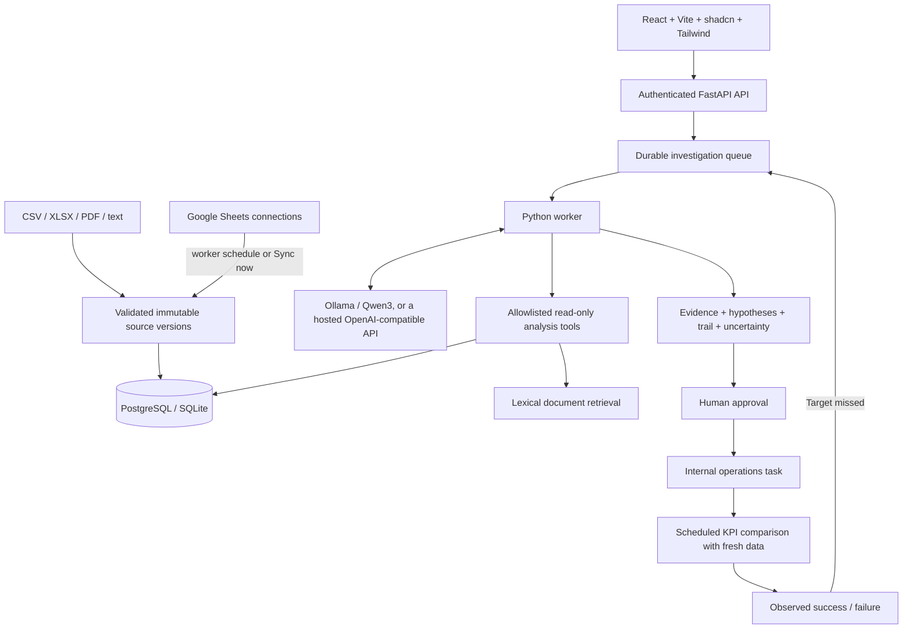

# SanketAI phase one

SanketAI is a single-business investigation workspace for a founder or operations administrator. The original proposal’s investigation loop is the product: observations lead to hypotheses, tool calls, evidence, counter-evidence, a conclusion, approval, and outcome monitoring. The frontend uses React/Vite rather than the Next.js it proposed, as requested.

## Investigation execution

The API validates input, snapshots the active source IDs, and returns HTTP 202. A separately supervised worker claims the job with an atomic database update. Tool results are committed after every step, so the React workspace can poll progress and the API remains responsive during model inference. A crashed job can be recovered after its 30-minute lease expires; three recovery attempts are allowed. Lease tokens prevent a superseded worker from overwriting a recovered job. Run one worker initially; PostgreSQL supports multiple claimants, but task throughput and recovery under concurrent load still need deployment-specific testing.

The model produces schema-validated planning steps and chooses allowlisted Python tools. These tools never run generated code, arbitrary SQL, filesystem paths, or outbound URLs. A mandatory verification pass runs even if the planner stops early. For supply and sales questions it checks inventory, supply, deliveries, marketing, customer activity, and documents. For margin, profit, and cost questions (or a discover run where contribution, but not revenue, is anomalous) it reconciles contribution and measures courier fees and supplier purchase prices. Final hypothesis references must resolve to collected evidence. Unsupported/rejected hypotheses require the appropriate evidence. High confidence is capped at medium because the inputs are observational.

The planner runs on local Ollama by default. `SANKET_LLM_PROVIDER=openai` sends the same schema-validated requests to a hosted OpenAI-compatible API instead; prompts then leave the machine and include source data. The planner sees each tool's new evidence claims and caveats rather than raw tool output, which keeps prompts within free-tier token limits. `auto` mode falls back visibly to deterministic analysis if the model is unavailable, rate-limited beyond a short wait, or its output fails validation. `ollama` mode fails the job instead. `deterministic` mode runs without an LLM. The deterministic explanation covers two scenarios. The supply scenario is supplier → stockout → product revenue. The margin scenario names a courier or supplier as a cause only when a measured price rise (fee per delivery or purchase unit cost, at least 5%) and a retrieved document naming the same party agree; a measured rise without a document stays inconclusive. Discount claims in documents are checked against like-for-like revenue per unit. Questions about churn, conversions, or other domains remain inconclusive rather than receiving an invented cause. Declining traffic competing with a supply explanation lowers confidence. The engine is not a general causal discovery or statistical inference system.

## Data and evidence

Source bytes are parsed and normalized into a database JSON snapshot, with a content checksum and immutable source ID. New investigations use the latest uploaded dataset of each type and all documents; completed and challenged investigations retain the original source IDs. Upload complete replacement datasets. Duplicate uploads reuse the existing source version. Arbitrary data editing is intentionally absent in this phase. Deleting a source removes it permanently and, after explicit confirmation, also deletes the investigations that used it and their actions (surviving follow-ups only lose their parent link); it is refused while such an investigation is queued or running, and is audited with the source's name, checksum and the removed investigation IDs. A development-only workspace reset (unavailable whenever demo loading is disabled, which production requires) deletes all sources, investigations and actions together, so no report outlives its evidence; the audit trail is kept. Sources can be downloaded as CSV or extracted text.

All currency is NPR. Revenue includes delivered/completed orders only. Comparisons use the latest 28 calendar days in the order dataset and the preceding 28 days. Missing baseline coverage prevents an actionable deterministic report. Decimal arithmetic computes monetary values before they are converted for JSON display. Contribution is recognized revenue minus cost of goods, recorded courier fees, and recorded expenses. Cost of goods uses the latest `purchases` unit cost on or before each sale; without purchase records it falls back to current catalog costs, which hides historical supplier price changes. Contribution is an estimate, not audited profit. The margin bridge reconciles the change exactly into revenue, cost-of-goods, courier-fee, and expense effects. The revenue difference is observed change, never automatically attributed lost revenue.

A Google Sheets connection stores a tab's CSV export URL, a schedule (hourly, 6-hourly, daily or manual) and its last sync status. The worker syncs due connections on its idle cycle; **Sync now** syncs immediately. Each fetch goes through the same validation and checksum de-duplication as an upload, so only changed data creates a new version (a sheet reverted to an earlier state makes that stored version current again). Fetches are HTTPS-only, re-check every redirect hop against an allowlist (`docs.google.com`, `*.googleusercontent.com`), ignore proxy environment variables, and are bounded by the upload size limit and a 30-second timeout. Only link-shared sheets work; OAuth for private sheets, Daraz and accounting connectors are deferred.

CSV and XLSX contracts are explicit. Dates must be ISO text; spreadsheet formulas are rejected. XLSX expansion, row counts, file sizes, PDF pages, and document chunks are bounded. PDF ingestion extracts text without OCR. Text retrieval ranks keyword overlap and attaches page/chunk citations. BGE-M3/Qdrant, vector retrieval, Pandas/NumPy, Olist-specific column mapping, and a separate MCP server are deferred; the working Python tools provide the extension boundary without another service or orchestration framework.

## Approval and automation

Reports with sufficient evidence can propose an internal operations task. Approval records an actor, timestamp, KPI baseline, target, and a follow-up due date. The action itself is the internal task record; an operator carries out the recommendation. Repeated approvals are idempotent, and conflicting decisions return HTTP 409. No email, CRM, or third-party workflow side effects are simulated.

The worker checks due tasks at least once per idle/polling cycle (normally every minute). KPI assessment requires a complete new 28-day outcome window after the report period. Late-delivery monitoring also requires a new deliveries version with complete current-order coverage. Missing outcome evidence keeps the task in monitoring and schedules another check in one day. Reaching the KPI target records observational success. A missed target records failure and queues a fresh investigation against the latest sources. This is not proof that the task caused the change.

## Access and operations

The bootstrap administrator is created once from environment configuration. Passwords use PBKDF2-SHA256 with 600,000 iterations and random salts. Sessions are opaque, hashed in storage, HTTP-only, SameSite=Lax, and expire after 12 hours. Mutations require a server-issued CSRF token; browser origins are checked. Login attempts are bounded in a shared database window. Password reset revokes existing sessions.

This release has one shared workspace and one administrator account, with no public signup or tenant isolation. Do not use it as a public multi-tenant SaaS. Production mode requires HTTPS, secure cookies, and disabled demo loading. Docker exposes only the frontend on loopback; the database and API remain on the internal network. Backups, TLS termination, resource limits, log retention, image digest pinning, and disaster recovery must be configured for the target host before real deployment.

Tests cover deterministic analysis, model orchestration through a stub, invalid data, auth/CSRF, source snapshots, lease recovery, approval idempotency, stale outcomes, scheduled checks, success, and re-investigation after failure. The real Ollama model, PostgreSQL concurrency, Docker runtime, and browser execution must be checked on an unrestricted host.
